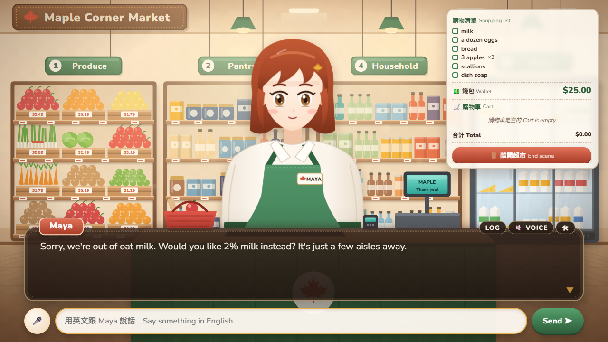
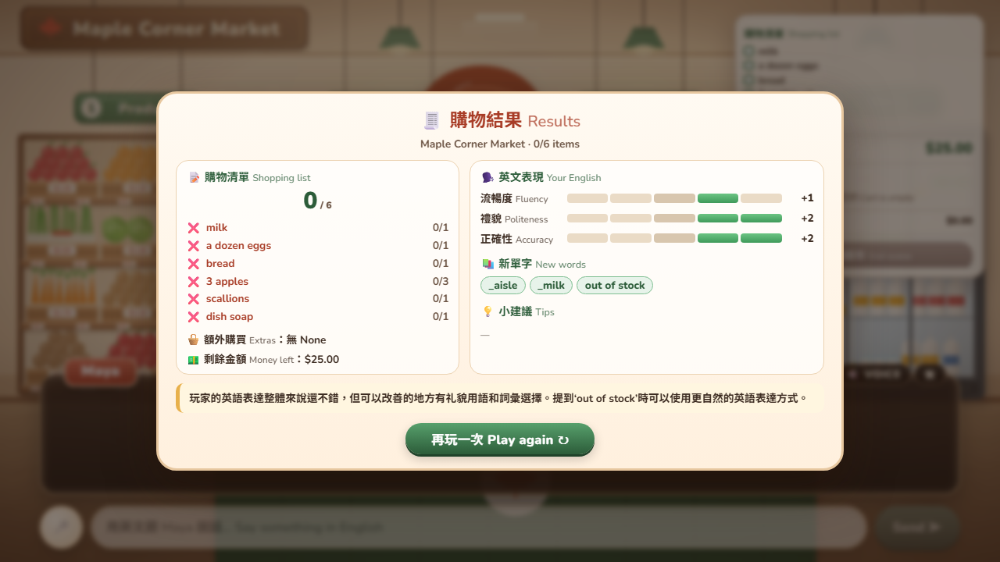

# 留學生活 galgame：超市場景（Stage 2）

> 最後更新：**2026-11-06**

這是一款要用英文過生活的留學 galgame，目前完成第一個場景。玩家在 Maple Corner Market 用英文跟店員 Maya 對話，要在 $25 以內買齊購物清單（剛好 $19.02）。Stage 2 依照單元 5 實測發現的四個錯誤，把原本寫在 Prompt 裡的規則搬進程式，並做了瀏覽器版的 galgame 畫面。




## 執行

```bash
pip install -r requirements.txt
cp .env.example .env        # 填入自己的設定
python server.py            # 打開 http://localhost:8000
```

其他入口：
- `python main.py [ollama|cloud]`：終端機版，除錯用
- `python replay.py [ollama|cloud]`：用單元 5 的 15 句實測腳本自動重播一場，比較改版前後或不同模型
- `python -m pytest`：測試引擎規則，不呼叫模型

### 模型（兩種可以同時用）
| 用途 | 預設 | 為什麼 |
| --- | --- | --- |
| 店員 Maya（每句話都會呼叫） | `PROVIDER=ollama`，本機 qwen2.5:7b | 免費，沒有速率限制 |
| 評分 Agent（場景結束呼叫一次） | `EVAL_PROVIDER=cloud`，雲端模型（例如 Groq、Gemini） | 只呼叫一次，用比較準的模型 |

標題畫面可以切換店員要用哪個模型。雲端可以用任何 OpenAI 相容的服務，設定 `LLM_BASE_URL`、`LLM_API_KEY`、`MODEL` 三行即可，範例見 `.env.example`。

> ⚠️ GitHub Models 已在 2026-07-30 停止服務，`models.github.ai` 現在不管什麼請求都只回純文字 `OK`。SDK 會報 `'tuple' object has no attribute 'choices'`，看到這個錯誤就是網址失效了。

## 架構

```
玩家（打字 / 🎤 語音）
   │ WebSocket
server.py ──► ai/session.py（一場場景：重試、事件串流）
               │
               ├─ Input guardrail：語言檢查（程式判斷，中文直接回固定台詞，0 token）
               ├─ 店員 Agent（ai/clerk.py）
               │     instructions = 人設 + scenes/supermarket/SKILL.md + 每輪資料庫狀態
               │     tools = find_product / add_to_cart / remove_from_cart / view_cart / checkout
               ├─ Output guardrail：工具呼叫被寫成文字、嘴上說做了卻沒呼叫工具
               └─ 評分 Agent（ai/evaluator.py，LLM-as-judge）→ 引擎檢查範圍後才採用
engine/（db、tools、state）：錢、價格、庫存、結果判定，全部由程式決定
web/：galgame 畫面（SVG 立繪、打字機對話框、HUD、TTS/STT、trace 面板、結算畫面）
```

| 資料夾 / 檔案 | 內容 |
| --- | --- |
| `engine/db.py` | SQLite 商品、玩家、購物籃、購買紀錄。每場遊戲一個記憶體資料庫 |
| `engine/tools.py` | 5 個工具和所有規則檢查。工具沒有價格參數，LLM 改不到錢 |
| `engine/state.py` | 畫面狀態、注入給店員的狀態摘要、場景結果判定 |
| `ai/clerk.py` | 店員人設、dynamic instructions、三道 guardrail、表情解析 |
| `ai/evaluator.py` | 評分 Agent：流暢度、禮貌、正確性、新單字、中文建議 |
| `ai/skills.py` + `scenes/<場景>/SKILL.md` | 場景規則手冊，場景開始時才載入。新增場景只要多一個資料夾 |
| `ai/models.py` | Ollama 和雲端兩種模型供應者 |
| `ai/session.py` | 一句話 → 工具、guardrail、台詞、狀態事件；CLI 和網頁共用 |
| `web/` | `index.html`、`style.css`、`app.js`、`art.js`（所有美術都是程式產生的 SVG） |

## Stage 2 改了什麼：把 Prompt 裡的規則搬進程式

| 單元 5 的錯誤 | 原因 | Stage 2 的做法 |
| --- | --- | --- |
| a dozen eggs 填成 quantity 12 | 工具說明沒寫單位 | 參數用 Pydantic 限制 1～20，說明寫清楚是「包裝數」；回傳附上單位；超過庫存時提醒「數的是包裝」 |
| 工具呼叫寫成文字 | 7B 模型的格式問題 | Output guardrail 偵測 JSON 和 `find_product({...})` 兩種寫法：第一次退回重送，第二次起由程式代為執行 |
| 聽懂中文 | Prompt 規則沒被遵守 | Input guardrail（`run_in_parallel=False`）先用程式判斷，觸發就完全不呼叫模型 |
| 狀態漂移 | 模型自己記購物籃 | Dynamic instructions：每輪由引擎把購物籃、餘額、清單完成度寫進 instructions |
| **新發現**：說 "Adding…" 卻沒呼叫工具 | 模型以為說了就是做了 | Output guardrail 比對本輪的工具紀錄，說了沒做就退回重做 |
| **新發現**：平行工具呼叫搶同一個 SQLite 連線 | SDK 會平行執行工具 | 每場遊戲一把鎖，工具依序執行 |
| **新發現**：付款後模型一直重複呼叫工具 | 唯讀工具也被擋 | 付款後唯讀工具照常可用；超過 max turns 而且已付款時，由程式說結尾台詞 |

### 實測：照單元 5 的腳本重播（Ollama qwen2.5:7b）
| 版本 | 結果 | 主要問題 |
| --- | --- | --- |
| 單元 5（Stage 1） | 0/6，14 輪 9 輪正確，35,108 tokens | 上表的四個錯誤 |
| 用 `response_format` 做結構化輸出 | 0/6，**0 次工具呼叫** | 見下方發現 1 |
| 改成表情標籤 + 狀態注入 | 1/6 | 說 "Adding…" 卻沒加 |
| + 先別查、直接加入的規則 | 0/6 | 雞蛋數量正確了，但沒有真的結帳 |
| + claim guardrail、函式格式偵測、資料庫鎖 | **6/6，剩 $5.98，9 輪結束，23,534 tokens** | 店員質疑清單外的衛生紙（已修正規則） |

小模型每次的結果差很多，同樣的版本也可能有不同結果，上表都只跑一次，樣本很小。能確定的是方向：錯誤一旦改由程式檢查，就不會再發生。

### 發現
1. **結構化輸出和工具呼叫在 Ollama 上互相衝突。** `response_format` 會用文法限制解碼，模型被迫一開始就吐 JSON，所以再也不會呼叫工具。改成請模型在台詞前標 `[happy]`，由程式解析，解析失敗就用 `neutral`。
2. **「說了」不等於「做了」。** 工具呼叫文字化修好之後，最大的錯誤變成模型口頭說已經加入購物籃。這只能拿工具紀錄比對，靠 Prompt 擋不住。
3. **給模型越多狀態，它越會拿來用。** 注入購物清單解決了建議拿錯東西的問題，卻讓店員知道了不該知道的事（質疑玩家買清單外的東西）。狀態也要標明能不能說出口。

## 畫面功能
- 16:9 視覺小說版面，手機直向時 HUD 會收合
- Maya 有 6 種表情（neutral / happy / thinking / sorry / confused / surprised），由店員 Agent 每句話自己選，說話時嘴巴會動
- 打字機效果的對話框，點擊或按 Space 可以跳過；LOG 可以看歷史對話
- 🎤 按住說英文（Web Speech API 語音辨識）；🔊 Maya 會念出台詞（TTS）
- 🛠 Trace 面板：工具呼叫的輸入和輸出、guardrail 事件、每輪 tokens
- 結算畫面：清單完成度、剩餘金額、評分 Agent 的分數、新單字和中文建議

## 下一步
- 把 5 個工具包成 MCP server
- 模擬玩家 Agent：自動扮演英文程度不同的留學生，產生新的測試劇本
- 接上口說教練的發音分數，加入玩家檔案（英文能力、金錢、體力）
- 下一個場景：上課（知識庫出題）

## 更新日誌
- **2026-11-06**：Stage 2。規則搬進程式（三道 guardrail、狀態注入、數量單位）、評分 Agent、場景 Skill、瀏覽器 galgame 畫面、重播腳本與測試，`.env` 不再進版控
- **2026-11-02**：Stage 1。終端機版超市雛型，5 個工具，Ollama qwen2.5:7b 實測 15 句
